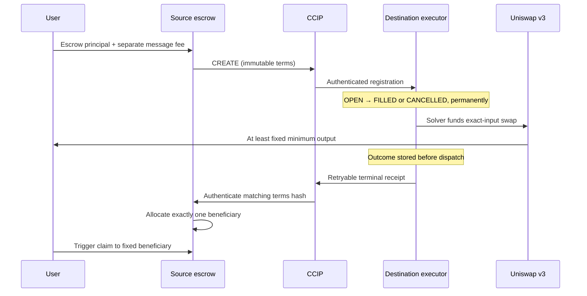

<p align="center">
  
</p>

# Bisharp

[Live frontend](https://bisharp.netlify.app/) · [Source code](https://github.com/Samarth208P/bisharp)

Conditional cross-chain orders with **Next.js, Foundry, Chainlink CCIP 2.0 and Uniswap v3**. User principal stays in a source escrow; a designated solver supplies destination tokens and swaps them to the user's fixed recipient. An authenticated terminal receipt allocates either solver payment or a user refund on the source.

**Current status: locally tested release candidate, not production-audited.** Public testnet contracts are deployed and source-verified; irreversible peer pairing awaits approval, so the route is not active yet. Source repository: [Samarth208P/bisharp](https://github.com/Samarth208P/bisharp). The working two-node local demo uses real Uniswap bytecode, a fixed local oracle and an explicitly unauthenticated transport fixture. It does not establish live CCIP delivery or prize eligibility. Testnet funds have been used for the recorded public deployments and pool liquidity.

## Run the complete local demo

Requirements: Node.js **22.16+**, npm, [Foundry](https://getfoundry.sh/introduction/installation/) (tested 1.5.1). Scripts locate Foundry under the usual user installation directory on Windows and Unix. Solidity 0.8.28, Cancun, optimizer 200 runs, via-IR. No private key is needed for local development.

```powershell
npm ci
npm run contracts:build
npm run abi
npm run demo:local
```

Keep that terminal running. The command refuses occupied ports, starts two isolated Anvil nodes, deploys and pairs contracts using Foundry, seeds a real v3 pool, runs a complete settlement/refund smoke test, then relays new local messages continuously. It writes the public local route to Git-ignored `.env.local`. Ctrl+C stops the fixture. RPCs:

| Network | EVM chain ID | CCIP selector in local fixture | RPC |
| --- | ---: | ---: | --- |
| Local source | 31337 | 1 | `http://127.0.0.1:8545` |
| Local destination | 31338 | 2 | `http://127.0.0.1:9545` |

In another terminal:

```powershell
npm run dev
```

Open <http://127.0.0.1:3000>. Connect a development wallet, click **Set 10 local ETH on both chains**, and mint source/destination bUSD under Funding & recovery. The local gas faucet never accesses public RPCs or wallet keys. Use a separate development wallet; public testnet ETH is not needed.

1. Enter source principal, the solver's destination input, minimum WETH output, trigger, expiry and optional recipient/solver. Blank recipient/solver defaults to your wallet.
2. Review exact identities and amounts. Approve exact source bUSD, review again, then create. Each action names its signing chain and switches the wallet when needed.
3. In All orders / solver, use the designated solver wallet. Approve destination bUSD, then execute the Uniswap fill. The local relayer registers orders, but does **not** choose or fund fills.
4. Send the stored terminal receipt, then claim the source payment. The destination fill persists if receipt dispatch fails.
5. For a separate order, request cancellation, wait for destination closure, send its receipt, then claim the refund. A fill can win a cancellation race. No source timeout-only refund exists.

The default local oracle price is exactly $2,000. bUSD is unbacked; local WETH wraps simulated Anvil ETH. The local transport is **not secure against a malicious local caller** and both transport/oracle fixtures reject public-chain deployment. In-app local transaction/address links open a read-only development inspector. Public CCIP links are only used for public routes.

## Multiple testnet routes

The contracts bind immutable terms to source/destination addresses, both selectors, order ID and protocol version. Settlement logic contains no hardcoded public network. The UI has presets for Ethereum Sepolia, OP Sepolia, Arbitrum Sepolia and Base Sepolia. **Presets are compatibility configuration, not verified deployments or live lane evidence.** Mainnets and mixed local/public routes are rejected by this testnet interface.

Configure paired deployments using `.env.local`:

```dotenv
NEXT_PUBLIC_ENABLE_LOCAL=false
NEXT_PUBLIC_ROUTES_JSON=[{"id":"eth-op","sourceChainId":11155111,"destinationChainId":11155420,"escrow":"0xYOUR_SOURCE_CONTRACT","executor":"0xYOUR_DESTINATION_CONTRACT"}]
```

Replace the addresses with actual deployments. Add more entries for independently deployed routes; do not reuse a contract paired to another counterpart. Custom RPCs use the public environment names in `.env.example`. `NEXT_PUBLIC_*` values are browser-visible and must never contain secrets. The simpler `NEXT_PUBLIC_SOURCE_ADDRESS`/`NEXT_PUBLIC_DESTINATION_ADDRESS` pair selects Ethereum Sepolia → OP Sepolia when the routes array is absent.

```powershell
npm run verify:routes
```

This read-only check verifies chain IDs, pairing, both selectors, router support in both directions, finality-required receiver policy and a fresh price. The frontend checks pairing/selectors independently and disables writes when they disagree. Each RPC is tracked separately, so a destination read outage does not prevent an earned source claim. Ten-order owner/global pages provide access to older orders.

## Architecture and safety boundaries



- One-time peer pairing burns pairing authority. No upgrade, arbitrary principal rescue, recipient rewriting or ongoing admin payout authority.
- CCIP receiver validates router, sender, source selector, protocol version, payload shape, order and terms hash. V2 receiver policy and V3 extra args require full finality; no faster-than-finality mode.
- CREATE/CANCEL can arrive out of order. Cancellation tombstones persist; late CREATE cannot reopen a closed destination order.
- An open source order is cancellable by its owner. At expiry anyone may request cancellation, but only destination CANCELLED makes a refund claimable. Source time alone never proves non-execution.
- Destination swaps use a fixed router/factory/pool/fee tier, a positive fresh nonfuture price, the solver's exact funding, immutable minimum output and deadline, balance-delta checks and cleared allowances. A reverted attempt changes no balances or terminal state.
- Terminal receipts are 128 bytes, versus 384 for CREATE/CANCEL. They bind the source's stored terms hash, preserve replay/idempotence checks, and cannot choose a beneficiary. Contradictory authenticated outcomes revert rather than allocate another credit.
- Principal liabilities, aggregate token credits and native fee-change credits have separate accounting. Failed token claims retain the same beneficiary and liability. Per-order and per-route exposure caps bound deposits.
- The solver and source payout use the same fixed EVM address. Terms are manually agreed and signed by order creation; a separate cryptographically signed solver-quote service is not implemented. A quote or eligible trigger never guarantees a fill.

The selected public testnet script omits a sequencer-uptime feed explicitly. The executor supports outage/grace checks and tests them, but a production L2 route must configure a reviewed uptime policy. Default test assets, feed policies and liquidity are not approved for real funds. Native fee quotes exclude separate transaction gas; reviewed fee funding includes a 20% buffer, with unused change claimable. Stored outcomes survive transport fee exhaustion, while recovery can remain pending indefinitely during an outage.

## Tests, gas and reproducibility

```powershell
npm run contracts:test
npm run test:ui
npm run test:integration
npm run typecheck
npm run format:check
npm run build
npm run check:public-build
```

`test:integration` deploys fresh contracts on two local Anvil chains, runs real
Uniswap swaps and settlement/refund checks, then stops its own nodes without
rewriting `.env.local`. It refuses occupied ports. For a check alongside an
existing demo, set `BISHARP_LOCAL_SOURCE_PORT=18545` and
`BISHARP_LOCAL_DESTINATION_PORT=19545`; custom ports apply only to this smoke
mode. See [the hardening review](docs/HARDENING_REVIEW.md) for the latest fixes,
verification results and remaining limits.

Extended deterministic campaign (PowerShell; ensure `forge` is on PATH, or use `node scripts/forge.mjs`):

```powershell
$env:FOUNDRY_FUZZ_RUNS = '10000'
$env:FOUNDRY_INVARIANT_RUNS = '1024'
$env:FOUNDRY_INVARIANT_DEPTH = '128'
node scripts/forge.mjs test --fuzz-seed 0x6d756d626169 --json > deployments/local-test-results.json
node scripts/test-report.mjs deployments/local-test-results.json 0x6d756d626169
```

Recorded results: [reports/foundry-results.json](reports/foundry-results.json), [reports/GAS.md](reports/GAS.md), [.gas-snapshot](.gas-snapshot), [deployments/local-smoke-summary.json](deployments/local-smoke-summary.json). Raw test logs are excluded from Git; the summary contains no keys. Tests include real official Uniswap pool bytecode, fuzzed 6/18-decimal amount conservation and output, adversarial message ordering/replay/races, stalled return receipts, invalid oracle answers, sequencer recovery boundaries, frozen claims, token callbacks, exposure caps and source solvency. Frontend input/route tests reject silent rounding, invalid identities, overflows, same-chain/mainnet/duplicate/mixed routes.

The build checker verifies that locally configured deployment keys are absent from public static assets; it never prints their values. This is a targeted check, not a substitute for independent review. Eight frontend/API tests cover inputs, routes and the local faucet boundary. Run the commands above locally to verify contracts, frontend behavior, the production build and the two-chain integration.

## Deploy the frontend on Netlify

Hosted frontend: [bisharp.netlify.app](https://bisharp.netlify.app/). Hosting is
complete; contract pairing and public CCIP round-trip validation remain pending.

Import [Samarth208P/bisharp](https://github.com/Samarth208P/bisharp) and select
branch `main`. Leave the base directory at the repository root. The checked-in
`netlify.toml` sets build command `npm run build`, publish directory `.next`,
Node.js 22 and `NEXT_PUBLIC_ENABLE_LOCAL=false`. Netlify automatically supplies
the Next.js adapter; no Foundry installation or contract compilation is needed
to host the frontend. Keep server rendering enabled for the route handlers.

Add these public environment variables in Netlify with **Builds** scope, then
deploy (or redeploy after changing them):

```dotenv
NEXT_PUBLIC_ENABLE_LOCAL=false
NEXT_PUBLIC_RPC_URL=https://ethereum-sepolia-rpc.publicnode.com
NEXT_PUBLIC_OP_RPC_URL=https://sepolia.optimism.io
NEXT_PUBLIC_SOURCE_ADDRESS=
NEXT_PUBLIC_DESTINATION_ADDRESS=
```

Set `NEXT_PUBLIC_SOURCE_ADDRESS` to the verified Ethereum Sepolia SourceEscrow
and `NEXT_PUBLIC_DESTINATION_ADDRESS` to its paired OP Sepolia DestinationExecutor.
They must be public-chain deployments, not addresses from the local Anvil demo.
Public addresses and current pairing status are recorded in
[deployments/README.md](deployments/README.md). Keep both addresses unset until
pairing is complete; the interface shows
an unconfigured route and disables order creation until valid deployments are set.

`NEXT_PUBLIC_SOLVER_ADDRESS` is optional; without it, the order form defaults to
the connected wallet. For additional deployed routes use `NEXT_PUBLIC_ROUTES_JSON`
and the corresponding RPC variables documented above instead of the simple address
pair. Leave that JSON variable unset for the initial deployment. RPC URLs must allow
browser requests over HTTPS; any provider key inside a public RPC URL is visible
to visitors and should have provider-side origin restrictions.

The frontend needs no private keys, seed phrases, Netlify token, Foundry secrets,
`PRICE_FEED` or `MAX_PRICE_AGE`. Users sign through their own wallets. The local
faucet and explorer are disabled on Netlify. Hosting the frontend does not deploy
contracts, run a solver or establish live CCIP delivery. GitHub Actions are not used.

## Public testnet deployment

`contracts/script/DeployCross.s.sol` prepares Ethereum Sepolia → OP Sepolia using official CCIP routers, OP's canonical v3 factory/position manager/WETH, the verified ETH/USD proxy and a locally deployed unchanged official original SwapRouter artifact. The original router ABI has a deadline and must **not** be replaced with SwapRouter02's different ABI. The destination script seeds at most 0.03 OP Sepolia ETH of test liquidity with minimum-amount protection. It checks chain IDs, deployed dependencies and feed freshness. See [deployments/README.md](deployments/README.md).

The public contracts and funded pool are recorded in `deployments/source.json`, `deployments/destination.json` and `deployments/public-transactions.json`. Both main contracts have exact-match Sourcify verification. Pairing is still pending explicit approval; authenticated CREATE/FILLED/CANCELLED round trips remain outstanding. No broadcast is needed for local work. The disposable testnet key is in Git-ignored `.env`; the script supports an explicit key there or an encrypted keystore as documented by the original single-chain script. Never publish it or use it with real funds. A simulation's predicted addresses are not deployment evidence.

## Partner requirements

Targets: **Chainlink CCIP 2.0** and **Uniswap Foundation**. See [docs/PARTNER_REQUIREMENTS.md](docs/PARTNER_REQUIREMENTS.md), [FEEDBACK.md](FEEDBACK.md).

- Chainlink integration code is implemented and tested locally. Actual CCIP 2.0 on-chain state-change/message evidence remains outstanding; the local mock cannot satisfy it.
- Uniswap v3 integration is implemented and exercised against official bytecode, including the two-node demo. `FEEDBACK.md` is present. Repository: [Samarth208P/bisharp](https://github.com/Samarth208P/bisharp). The repository is public; the developer feedback form remains outstanding.
- The frontend is hosted at [bisharp.netlify.app](https://bisharp.netlify.app/), and both main contracts have exact-match Sourcify verification. Explorer-specific verification, event eligibility, a recorded demo and submission remain separate tasks. No partner form or competition submission has been performed. Public deployments are recorded separately; live CCIP round-trip evidence remains outstanding.

The earlier `Bisharp.sol` single-chain implementation remains only as a tested reference; the main UI and new contracts use the cross-chain lifecycle.
